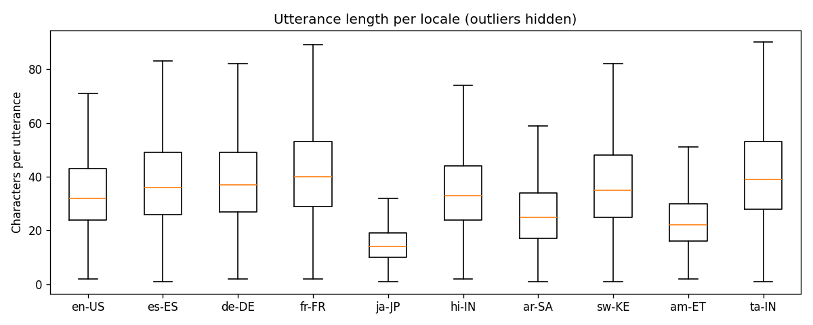

# Dataset Report

Generated by `python -m src.data.eda` from the raw MASSIVE files. Do not edit by hand; the data-quality analysis is in `reports/data_quality_issues.md`.

## Overview

- Dataset: MASSIVE 1.1 (licence CC-BY-4.0)
- Locales analysed: 10 (en-US, es-ES, de-DE, fr-FR, ja-JP, hi-IN, ar-SA, sw-KE, am-ET, ta-IN)
- Utterances: 165,210
- Distinct intents across these locales: 60
- Distinct slot types across these locales: 55

## Size and length per locale

| Locale | Tier | Records | Train | Dev | Test | Intents | Slot types | Utterances with slots | Median words | Median chars | p95 chars |
|---|---|---|---|---|---|---|---|---|---|---|---|
| en-US | high | 16,521 | 11,514 | 2,033 | 2,974 | 60 | 55 | 67.3% | 6 | 32 | 65 |
| es-ES | high | 16,521 | 11,514 | 2,033 | 2,974 | 60 | 55 | 66.3% | 7 | 36 | 76 |
| de-DE | high | 16,521 | 11,514 | 2,033 | 2,974 | 60 | 55 | 67.2% | 6 | 37 | 73 |
| fr-FR | high | 16,521 | 11,514 | 2,033 | 2,974 | 60 | 55 | 65.8% | 7 | 40 | 79 |
| ja-JP | high | 16,521 | 11,514 | 2,033 | 2,974 | 60 | 55 | 67.0% | 1 | 14 | 29 |
| hi-IN | mid | 16,521 | 11,514 | 2,033 | 2,974 | 60 | 55 | 67.2% | 7 | 33 | 68 |
| ar-SA | mid | 16,521 | 11,514 | 2,033 | 2,974 | 60 | 55 | 67.3% | 5 | 25 | 53 |
| sw-KE | low | 16,521 | 11,514 | 2,033 | 2,974 | 60 | 55 | 66.8% | 6 | 35 | 74 |
| am-ET | low | 16,521 | 11,514 | 2,033 | 2,974 | 60 | 55 | 67.0% | 5 | 22 | 45 |
| ta-IN | low | 16,521 | 11,514 | 2,033 | 2,974 | 60 | 55 | 67.3% | 5 | 39 | 81 |

Word counts split on whitespace, so they are not meaningful for ja-JP, which is written without spaces; use character counts there.

## Data-quality checks per locale

Judgment columns count utterances where most annotators answered "No" (intent or slots), or where most did not mark the text as the target language. en-US has no judgments.

| Locale | Missing | Duplicate IDs | Duplicate utterances | Texts in >1 partition | Malformed markup | Empty slot values | Markup ≠ text | Intent mismatch | Slot mismatch | Not target language |
|---|---|---|---|---|---|---|---|---|---|---|
| en-US | 0 | 0 | 89 | 37 | 0 | 0 | 0 | n/a | n/a | n/a |
| es-ES | 0 | 0 | 629 | 217 | 0 | 0 | 0 | 2 (0.0%) | 61 (0.4%) | 1 (0.0%) |
| de-DE | 0 | 0 | 485 | 196 | 0 | 0 | 0 | 305 (1.8%) | 449 (2.7%) | 4 (0.0%) |
| fr-FR | 0 | 0 | 612 | 219 | 0 | 0 | 0 | 52 (0.3%) | 894 (5.4%) | 2 (0.0%) |
| ja-JP | 0 | 0 | 886 | 295 | 0 | 0 | 0 | 54 (0.3%) | 95 (0.6%) | 7 (0.0%) |
| hi-IN | 0 | 0 | 582 | 216 | 0 | 0 | 0 | 277 (1.7%) | 94 (0.6%) | 15 (0.1%) |
| ar-SA | 0 | 0 | 964 | 306 | 0 | 0 | 0 | 2037 (12.3%) | 328 (2.0%) | 575 (3.5%) |
| sw-KE | 0 | 0 | 721 | 243 | 0 | 0 | 0 | 23 (0.1%) | 255 (1.5%) | 2 (0.0%) |
| am-ET | 0 | 0 | 472 | 159 | 0 | 0 | 0 | 27 (0.2%) | 231 (1.4%) | 2 (0.0%) |
| ta-IN | 0 | 0 | 598 | 217 | 0 | 0 | 0 | 905 (5.5%) | 56 (0.3%) | 1 (0.0%) |

## Resource tiers

| Tier | Locales | Mean median chars | Mean intent mismatch | Mean slot mismatch | Mean duplicate utterances |
|---|---|---|---|---|---|
| high | en-US, es-ES, de-DE, fr-FR, ja-JP | 31.8 | 0.6% | 2.3% | 540.2 |
| mid | hi-IN, ar-SA | 29.0 | 7.0% | 1.3% | 773.0 |
| low | sw-KE, am-ET, ta-IN | 32.0 | 1.9% | 1.1% | 597.0 |

Judgment means exclude en-US, which has no judgments.

## Class balance (train partition)

| Locale | Smallest intent | Largest intent | Ratio |
|---|---|---|---|
| en-US | 4 | 810 | 202.5x |
| es-ES | 4 | 810 | 202.5x |
| de-DE | 4 | 810 | 202.5x |
| fr-FR | 4 | 810 | 202.5x |
| ja-JP | 4 | 810 | 202.5x |
| hi-IN | 4 | 810 | 202.5x |
| ar-SA | 4 | 810 | 202.5x |
| sw-KE | 4 | 810 | 202.5x |
| am-ET | 4 | 810 | 202.5x |
| ta-IN | 4 | 810 | 202.5x |

Rarest intents in en-US (all partitions): `cooking_query` (6), `music_dislikeness` (20), `audio_volume_other` (24), `general_greet` (28), `iot_hue_lighton` (30)

Most frequent slot types in en-US: `date` (2571), `place_name` (1576), `event_name` (1418), `person` (1215), `time` (1127)

Rarest slot types in en-US: `music_album` (2), `game_type` (2), `sport_type` (6), `transport_descriptor` (10), `audiobook_author` (12)

## Cross-locale checks

- IDs present in every locale: 16,521
- IDs missing from at least one locale: 0
- IDs assigned to different partitions in different locales: 0
- Same intent set in every locale: yes

## Figure

