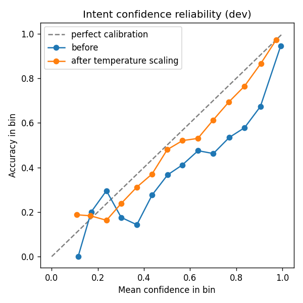

# Calibration and Fallback

Generated by `python -m src.models.fallback` for `artifacts/runs/xlm-roberta-base-runB-oos/best`. Dev data and the challenge set only; test data not used.

- Temperature fitted on dev: **1.393**. ECE before 0.0761, after 0.0201 (15 equal-width bins). 
- Chosen rule: **energy < 7.036 → handoff**, chosen on tune + dev only. A person must review it and copy it into `fallback.threshold` in `configs/project.yaml`.
- **Held-out routing: 90.9%** (NFR-3 target 95%); 50.9% of held-out items were routed by the predicted `out_of_scope` intent alone.
- Dev (in-scope): 77.9% answered, 22.1% handed off; accuracy when answered 95.2%; wrong answers given on 3.7% of inputs.

## Methods compared

| Method | Threshold | Tune routed | Dev answered | Held-out routed |
|---|---|---|---|---|
| max_prob | 0.92 | 96.4% | 69.5% | 89.1% |
| margin | 0.88 | 96.4% | 71.0% | 87.3% |
| energy (chosen) | 7.036 | 96.4% | 77.9% | 90.9% |

## Held-out routing by category (chosen method)

| Category | Items | Routed to handoff |
|---|---|---|
| support_out_of_domain | 25 | 92% |
| adversarial | 10 | 70% |
| mixed_language | 10 | 100% |
| gibberish | 3 | 100% |
| empty | 1 | 100% |
| symbols | 2 | 100% |
| very_long | 1 | 100% |
| unsupported_language | 3 | 100% |

## Held-out routing by language (chosen method)

English items share topics with the external out-of-scope training data, so English may be optimistic.

| Language | Items | Routed to handoff |
|---|---|---|
| en-US | 4 | 75% |
| es-ES | 6 | 100% |
| de-DE | 4 | 75% |
| fr-FR | 5 | 80% |
| ja-JP | 4 | 100% |
| hi-IN | 5 | 60% |
| ar-SA | 4 | 100% |
| sw-KE | 5 | 100% |
| am-ET | 4 | 100% |
| ta-IN | 5 | 100% |
| none | 6 | 100% |
| ru-RU | 1 | 100% |
| it-IT | 1 | 100% |
| pl-PL | 1 | 100% |

## Dev fallback rate by locale (chosen method)

A locale handed off far more often than others is a fairness problem as well as a coverage one.

| Locale | Handed off |
|---|---|
| en-US | 18.4% |
| es-ES | 19.5% |
| de-DE | 19.8% |
| fr-FR | 20.6% |
| ja-JP | 18.4% |
| hi-IN | 21.1% |
| ar-SA | 29.2% |
| sw-KE | 23.4% |
| am-ET | 25.0% |
| ta-IN | 25.4% |

## Trade-off for the chosen method (every 5th threshold)

| Threshold | Tune out-of-scope routed | Dev answered |
|---|---|---|
| 4.44 | 67.3% | 99.9% |
| 5.795 | 81.8% | 94.9% |
| 6.28 | 83.6% | 89.9% |
| 6.656 | 92.7% | 84.9% |
| 6.939 | 94.5% | 79.9% |
| 7.172 | 96.4% | 74.9% |
| 7.362 | 98.2% | 69.9% |
| 7.512 | 98.2% | 64.9% |
| 7.636 | 98.2% | 59.9% |
| 7.754 | 98.2% | 54.9% |
| 7.85 | 98.2% | 50.0% |
| 7.967 | 98.2% | 45.0% |
| 8.063 | 98.2% | 40.0% |
| 8.156 | 98.2% | 35.0% |
| 8.24 | 100.0% | 30.0% |
| 8.323 | 100.0% | 25.0% |
| 8.41 | 100.0% | 20.0% |
| 8.499 | 100.0% | 15.0% |
| 8.628 | 100.0% | 10.0% |
| 8.761 | 100.0% | 5.0% |
